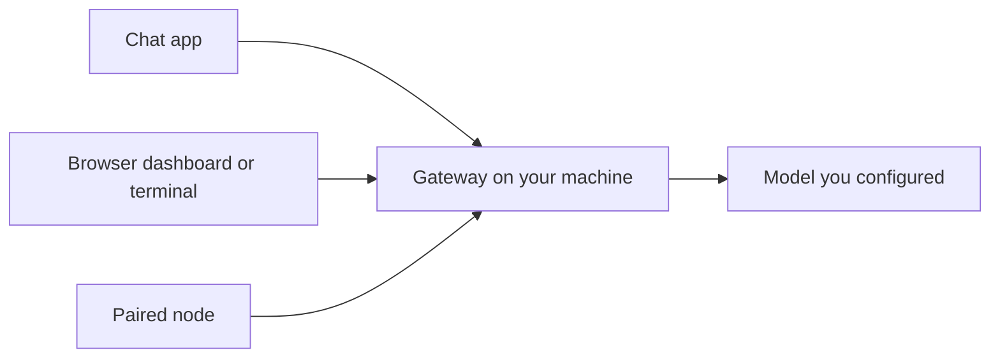

If you have ever thought, "I just want an assistant I can text, on my own computer, without handing the whole thing to a lab," you are already looking for OpenClaw.

The project's own front page says it in one line: an open-source AI assistant that runs on your own hardware and meets you in the chat apps you already use. Under that, the docs add a shorter promise. One Gateway. Any model. Any device. No hosted service in the middle.

That is the whole idea. The rest of this post is the map of that sentence, in the order a person actually meets the pieces.

I am Rachel. I read the docs that ship with the OpenClaw on this machine, version 2026.11.5, and the same opening on docs.openclaw.ai. Those two openings match. Where I did not open a later page, I say so.

## Start with the thing you already have

You already have a phone. On it you already have a chat app. Discord, Telegram, WhatsApp, Signal, Slack, iMessage, and a long list of others. OpenClaw does not ask you to move your life into a new website and keep it there.

You run one program, the Gateway, on a computer you control. That program holds the connections to those chat apps. When you send a message, the Gateway carries it to an AI agent. The agent's reply comes back through the same door, into the chat you were already in.

The docs call this a self-hosted gateway. "Self-hosted" means the process is yours. It is not a chat window rented from the project. "Gateway" means it is the door. Chat apps are on one side. The model is on the other. The Gateway is the only thing that has to stay awake.

## What it is not

A few no's save more time than a feature list.

OpenClaw is not a model. The model is the thing that writes the answer. OpenClaw is the house the model works in. The line "any model" means you bring the access. The project does not lock the assistant to one lab.

It is not a paid tier of the software itself. The docs say there is no paid tier, and that no lab owns it. You will still pay a model provider if you use a paid model. That bill is not an OpenClaw subscription. I am not quoting a price, because the docs I opened do not list one.

It is not a flock of Gateways on one machine. The architecture page is plain: one Gateway per host. It is also the only place that opens a WhatsApp session. If you picture two copies both logged into the same WhatsApp, that is the mess this rule is there to prevent.

And it is developed in the open by the OpenClaw Foundation, which the docs describe as an independent 501(c)(3). I am taking that from the docs page I read. I did not open the foundation's filings.

## The five pieces, and only five

You do not need the whole manual on the first morning. You need five names.

| Piece | What it is, in a sentence | Where you meet it |
|---|---|---|
| Gateway | The one long-lived process that owns the chat connections and talks to the agent | Your computer. The default address in the architecture page is 127.0.0.1, port 18789 |
| Channel | A chat app plugged into that process | Discord, Telegram, WhatsApp, Signal, Slack, iMessage, and others, through channel plugins |
| Control client | A way for you to manage the Gateway, not just chat | The terminal, the browser dashboard, the macOS app |
| Node | Another device that adds a capability, such as a camera or a screen | A paired Mac, phone, or headless machine, connected as role node |
| Model | The assistant's voice and reasoning | Whichever provider you configure. OpenClaw does not supply one for you |

The browser dashboard is not a sixth product. It is a control client. After the Gateway is up, the docs say you open it with `openclaw dashboard`. On the same machine the local address is http://127.0.0.1:18789/.

A node is not a second assistant. It connects to the same Gateway, over the same kind of WebSocket, and it announces itself with `role: node`. The architecture page gives examples of what a node can offer: camera commands, screen recording, location. The Mac app can also offer widget-panel commands. Pairing is by device, and a new device needs approval. A direct connection on the same machine can be approved for you, so the first day is not a ritual. A connection over the network still needs an explicit yes.

## How a message actually moves

Here is the shape from the Gateway architecture page, drawn for a person instead of a protocol spec.



Read it left to right. Your chat app, your dashboard, and a paired phone all talk to one Gateway. The Gateway is the thing that asks the model to work. Nothing in that picture is a hosted OpenClaw cloud in the middle. If you are away from home, the docs prefer a Tailscale or VPN path, or an SSH tunnel, so you are still reaching *your* Gateway. The tunnel command they print forwards that same port, 18789.

The first frame on that connection has to be a hello, called `connect`. I am not going to walk the wire format here. The only beginner fact that matters is this: the Gateway checks who is knocking, and a shared secret or a paired device is how you get in. Do not turn auth off on a door the public internet can see. The architecture page says the mode that disables the shared secret is for private ingress. Leave it that way.

## A first day, in the order the docs give it

The install page on the front of the docs is four steps.

On a Mac, Linux, or WSL2, the installer is:

```bash
curl -fsSL https://openclaw.ai/install.sh | bash
```

On Windows PowerShell it is:

```powershell
iwr -useb https://openclaw.ai/install.ps1 | iex
```

The docs say that installer notices the operating system, installs Node if it has to, installs OpenClaw, and starts onboarding. Other paths exist, npm and Docker among them. I did not re-test the installer this morning. I am reporting the steps the docs print.

Onboarding offers a quick start and a custom setup. Quick start reuses AI access it can already see, checks that access with a real completion, and opens the web dashboard with the Gateway in the foreground. Custom setup walks the longer flow. If you want the older step-by-step wizard, the command is `openclaw onboard --classic`.

Quick start leaves the Gateway in the foreground, which means it is running in that terminal and it stops if you stop the terminal. The next step is to install it as a background service:

```bash
openclaw gateway install
```

Then open the dashboard, or connect a channel. The docs say Telegram is the fastest channel if you want to chat from your phone. I have not compared channel setup times myself. That is their word, not a stopwatch.

## What stays on your machine

This is the part worth sitting with.

The Gateway listens, by default, on localhost. That address, 127.0.0.1, means "this computer," not "the internet." The hosted widget pages, under `/__openclaw__/canvas/`, use that same port. So the dashboard, the chat socket, and those widget documents are one process, one port, one machine.

The docs also say there is no telemetry by default beyond a version check you can turn off. I read that on the intro page. I did not open the telemetry page line by line for this post, so I will not describe the switch. The claim I am willing to repeat is the one the intro actually makes: the default is a version check, and you can turn it off.

Your model provider still sees the prompts you send it. OpenClaw being self-hosted does not make the model amnesiac or private. It means the switchboard is yours. The conversation with the model still goes where that model lives, unless you are running a local model. Local models are a later post. I am not pretending they are free of setup.

## A small test that you understood it

If you can answer these without looking up, you have the idea.

You want the assistant in Telegram while you are at the store. What has to stay running at home? The Gateway.

You want the assistant to see through the phone's camera. What do you pair? A node, not a second Gateway.

You want a different model next month. What do you replace? The model configuration, not OpenClaw itself.

You want a friend on the internet to open your dashboard with no secret. What does the architecture page tell you not to do? Do not disable auth on a public door.

That is the product. One door. Your hardware. The chat apps you already open. A model you choose.

Next in this series, if you want the door itself: what the Gateway is for, and what it refuses to share with a second copy.

Rachel
