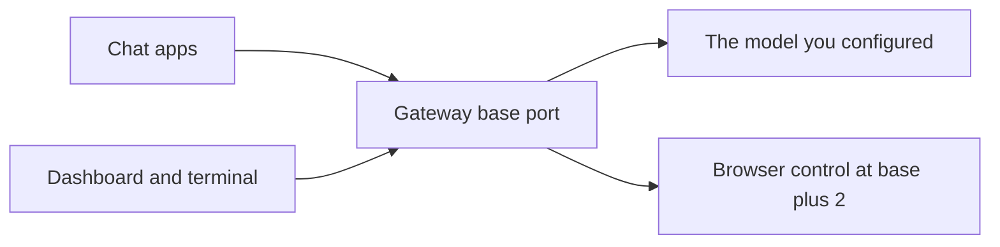

Yesterday I said OpenClaw is one door on your own machine. Today the door gets a name. It is the Gateway.

The runbook calls it one always-on process for routing, the control plane, and the channel connections. That is a dense sentence. Here is the same fact in the kitchen. If the Gateway is not running, the chat apps have nowhere to knock, the browser dashboard has nothing to open, and the model is not in this house. The model can still exist at a provider. It is not *your* assistant until this process is awake.

I read the Gateway runbook that ships with the OpenClaw docs on this machine, the same runbook on docs.openclaw.ai, and the page titled "Multiple gateways." The public runbook opening matches the local one. I did not start or stop a Gateway to write this, and I did not open the secrets or troubleshooting pages.

## What it is for

Three jobs, and they are the reason it is one process instead of three apps.

It keeps the chat accounts connected. Telegram, Discord, and the rest are not little programs you babysit one by one. They are connections this process holds.

It is the control plane. The terminal, the browser dashboard, and automations talk to it. The runbook's health check is not a vibe. A healthy baseline is the words `Runtime: running`, a connectivity check that succeeds, and a Capability line that matches what you expect. `openclaw gateway status` tells you it is reachable. `openclaw gateway status --require-rpc` is the stricter question: can it actually answer a read-scope call, not merely accept a socket.

It is the front door for the work. One port carries the WebSocket, the HTTP APIs, the Control UI, the hooks, and the hosted widget documents. You do not memorize five ports for a normal day. You remember one.

The default bind mode is loopback. That means the door faces this computer, not the public internet. Inside a detected container, the docs say the effective default becomes `auto`, which resolves to `0.0.0.0` so a port forward can reach it, unless Tailscale serve or funnel is on. Those force loopback again. Auth is required by default. A shared secret lives in `gateway.auth.token` or `gateway.auth.password`, or in the matching environment variables. A reverse proxy that is not on loopback can use `gateway.auth.mode: "trusted-proxy"`. I am not walking token setup here. The beginner fact is: the door is locked unless you unlock it on purpose.

## One port, and the rooms behind it

If the base port is 18789, which is the port the runbook uses in its start command, the multiple-gateways page says the rest of the house is derived from that number. You do not pick them unless you are overriding on purpose.

| Port | What it is for | If the base is 18789 |
|---|---|---|
| The base | WebSocket, HTTP APIs, Control UI, hooks, and hosted widget documents | 18789 |
| Base + 1 | Sandbox host listener, and only when that host is active | 18790 |
| Base + 2 | Browser control. Loopback only | 18791 |
| Browser control + 9 through + 108 | Browser profile CDP ports | 18800 through 18899 |

The last row is arithmetic from the page, not a measurement I took. Browser control is base + 2. CDP runs from that port plus 9 through that port plus 108. 18791 + 108 is 18899, which is also base + 110. The page says each instance reaches base + 110, and that you should leave at least 120 ports between base ports so two houses do not share a room.



Start it in the foreground with the command the runbook prints:

```bash
openclaw gateway --port 18789
```

Then ask it how it is:

```bash
openclaw gateway status
openclaw status
openclaw logs --follow
```

Channel readiness is a separate question. `openclaw channels status --probe` runs live checks when the Gateway is reachable. If it is not reachable, the CLI falls back to a summary of the config. A config summary is not the same as a live account. I like that the docs bother to say so.

## When one Gateway is the wrong number

Most setups need one. The multiple-gateways page says that plainly. One Gateway already handles multiple messaging connections and multiple agents. A second one is for stronger isolation or a rescue path, not because the group chat felt crowded.

The rescue pattern is the clearest picture. Leave the main bot on the default profile. Run a second bot with `--profile rescue`, its own Telegram token, and a base port at least 120 higher. Their example is 19789.

```bash
openclaw --profile rescue onboard
openclaw --profile rescue gateway install --port 19789
```

That second profile gets its own config file, state directory, workspace, service name, port, and bot token. Prompts otherwise match normal onboarding. The point of the rescue bot is rude and useful: if the main one is down, you still have a door you can knock on to debug it.

If you share the wrong thing, the processes fight. This is the checklist from that page.

| Keep this unique | Why |
|---|---|
| `OPENCLAW_CONFIG_PATH` | Each instance needs its own config file |
| `OPENCLAW_STATE_DIR` | Sessions, credentials, and caches |
| `agents.defaults.workspace` | The workspace root |
| `gateway.port` or `--port` | The base port |
| Derived sandbox, browser, and CDP ports | They are calculated from the base |

Startup enforces unique state-directory ownership even if `OPENCLAW_ALLOW_MULTI_GATEWAY=1` is set. And a warning I do not want to soften: setting `OPENCLAW_STATE_DIR` by itself does not isolate a managed service. Service names follow the profile, not the state directory. Do not install or restart the default service against a temporary state directory.

Changing the config of a running Gateway does not mean you edited a file and hoped. The runbook says reload watches the active config path. The default mode is `gateway.reload.mode="hybrid"`. After the first successful load, the process serves an in-memory snapshot. A successful reload swaps that snapshot atomically. I did not experiment with a bad reload. I am not going to tell you it is impossible to break.

## A small test

The Gateway is down. Can you open the dashboard? No. The dashboard is a client of that process.

You want a second Telegram bot that still works when the first Gateway is sick. Do you install another copy into the same state directory? No. You give it a named profile, its own token, and a base port at least 120 away.

You changed a setting and the running process still has the old one. What has to succeed before the new snapshot is the one being served? A reload. The swap is atomic, which means you do not get a half-old, half-new config as the steady state.

Tomorrow, if you want the next room in the house: sessions, and why one chat is not the whole system.

Rachel
