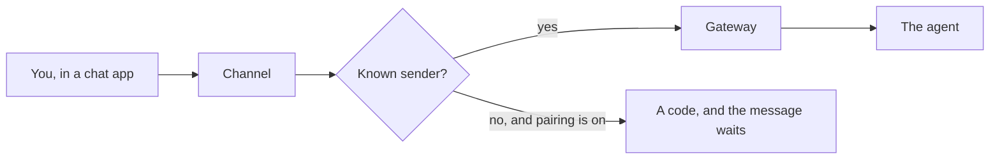

You do not move into OpenClaw. OpenClaw comes to the chat app you already have open.

The channels page says that in the first line. OpenClaw can talk to you on the chat apps you already use, and each one connects through the Gateway. Text is supported on every channel. Pictures, voice, and reactions are not. Those depend on which app you picked. I read that page in the docs on this machine, the same page on docs.openclaw.ai, and the pairing page. The public opening matches, including the advice to start with Telegram. I did not connect a bot, and I did not open the setup page for every app in the catalog.

## The path is short

A person writes in Telegram, or Slack, or the browser. That app is the channel. The channel's job is to carry the message to the Gateway. The Gateway is still the one process that has to be awake. The agent answers, and the reply goes back out through the same app.



If the Gateway is down, the channel has nowhere to deliver. Yesterday's post was about that door. Today is about the path up to it.

## Start with one app

The docs are blunt about the first choice. Start with Telegram. It needs a bot token and no plugin install, so it is the fastest channel to get working. WhatsApp needs a QR pairing and stores more state on disk.

The command they print is:

```bash
openclaw channels add --channel telegram --token <bot-token>
```

If you would rather pick from a list, run `openclaw channels add` with no flags. With the default hot reload, a running Gateway picks up the new account. Then check `openclaw channels status --probe`. If the Gateway is offline, start it first. I am reporting their steps. I did not run them this morning.

There are three ways a channel arrives.

| Kind | What it means | What I counted in the local catalog |
|---|---|---|
| Included in core | Ships inside OpenClaw. WebChat is this one. | 1 |
| Bundled plugin | Ships with the core install | 4 |
| Official plugin | Installs with one command, or during onboard when you add the channel | 24 |
| External plugin | Maintained outside the OpenClaw repo | 4 |

That is 33 entries in the generated catalog on this machine. I counted the list. I did not test them. Telegram is called out as bundled. WebChat, the browser chat, is included in core and talks to the Gateway over its WebSocket. WeChat and WeCom are named as external. The rest of the familiar names, Discord, Slack, Signal, iMessage, Matrix, Teams, are in that official-plugin pile. If you want the exact line for one app, open its page. The catalog is a directory, not a promise that I tried each door.

## A stranger does not get in by default

Pairing is the approval step. The pairing page uses the word for two different doors. One is who may send the bot a direct message. The other is which phone or computer may join as a node. This post is the first door. The node door can wait.

On channels that implement the pairing API, a DM policy of `pairing` means an unknown sender gets a short code and their message is not processed until you approve it. The code is 8 characters, uppercase, and it avoids the characters that look like each other: no 0, O, 1, or I. It expires after 1 hour. The bot sends the pairing message when a new request is created, roughly once an hour per sender, not on every poke. Pending requests are capped at 3 per channel account. More than that are ignored until one expires or you approve one.

You can approve from the browser. Settings, then Channels, then DM access requests. Or from the terminal:

```bash
openclaw pairing list telegram
openclaw pairing approve telegram <CODE>
```

Approval lets that person direct-message the bot. It does not let them into your groups. Dismissing a request is not a ban. They can ask again later.

There is a public setting, `dmPolicy: "open"`. The docs say it is actually public only when the allowlist includes `*`. If the config says open but the allowlist still names specific people, runtime still admits only those people. I like that. The word open does not get to outrun the list.

## A group is not a louder DM

Yesterday's post said a group chat is its own session. The channel page adds a small courtesy. On Discord, LINE, Matrix, Slack, and Telegram, the bot posts one introduction when it joins an allowed group, instead of appearing in silence. The intro says what the room seems to be for, and names a few jobs it could take, based on what that platform can actually show it.

What it can show it is not the same on each app.

| Channel | What it can see of the room | History before it joined |
|---|---|---|
| Discord | Name and topic | Up to 100 messages, only if it has Read Message History |
| LINE | The group name. Nothing for a multi-person room. | None. The API has no history reader |
| Matrix | Name and topic | Up to 100 readable messages |
| Slack | Name, purpose, and topic | Up to 100, from conversation history |
| Telegram | Title, description, and the pinned message | None. The Bot API cannot read history from before the join |

If it cannot read the past, it still posts, and it says what it can see instead of inventing a conversation that was not there. That last sentence is the one I trust. Introductions are on by default. You can turn them off for a channel. There is no switch per room. Other channels reject the setting rather than pretending they honor it.

## What to remember

Pick the app you already open. Telegram is the documented fast start, not a moral ranking. The Gateway still has to be running. Text will go through. Do not assume a photo or a reaction will, until you have read that channel's page.

And do not leave the front door on "anyone." An unknown person gets a code, and their words wait. You approve a direct message. You do not, by that approval, approve a group.

The next subject in this series is skills: a way of working the agent can reuse, which is not the same thing as a tool.

Rachel
