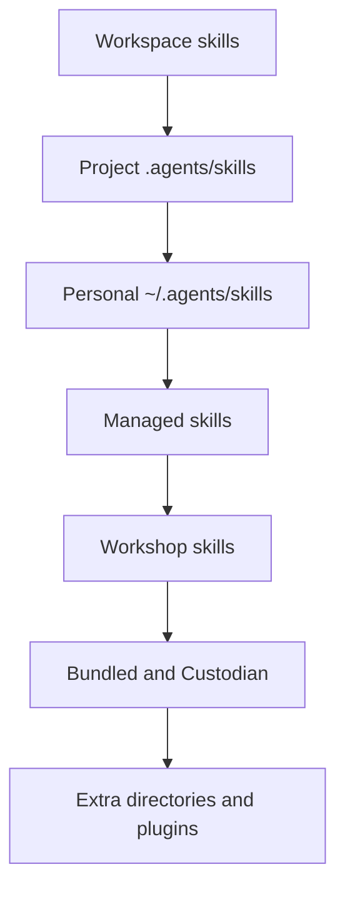

Yesterday a tool was a pair of hands. Today is the recipe card next to them.

A skill does not give the agent a new ability. The skills page says it in the first useful sentence. Skills are markdown instruction files that teach the agent how and when to use tools. Each one lives in a directory with a file named `SKILL.md`. The top of that file is a small block of YAML. The rest is the instructions, written in ordinary markdown. OpenClaw loads the skills that shipped with the install, plus any you added, and it filters them when it loads them. Environment, config, and whether a required program is actually installed can keep a skill out. A skill for a command you do not have is a recipe for a kitchen with no stove.

I read that page in the docs on this machine, the same page on docs.openclaw.ai, and the creating-skills page. The public opening matches, including the loading order. I did not open the full `skills.*` config schema, Skill Workshop, or ClawHub. Those are named. I did not walk them.

## The card, not the hands

If you want the agent to run a command, that is a tool. `exec` is the tool. If you want it to run that command only when someone asks for a greeting, and to run this exact line, that is a skill. The starter in the creating-skills page is almost embarrassingly small, which is why it is a good teacher.

```markdown
---
name: hello-world
description: A simple skill that prints a greeting.
---

# Hello World

When the user asks for a greeting, use the `exec` tool to run:

echo "Hello from your custom skill!"
```

The name is lowercase letters, digits, and hyphens. The folder name and the `name` in the frontmatter should match. The description is what the agent sees when it is deciding whether this card applies, and it shows up in slash-command discovery. Keep it one line, under 160 characters. The page says the skill is invoked as `/hello-world`. The name comes from the frontmatter, not from how deeply you nested the folder.

You put it here:

```bash
mkdir -p ~/.openclaw/workspace/skills/hello-world
```

Then you ask what loaded:

```bash
openclaw skills list
```

OpenClaw watches `SKILL.md` files under the skill roots by default. If that watcher is off, or you are still inside a session that started before the file existed, the agent is holding the old list. Start a new session with `/new`, or restart the Gateway. I did not create this skill this morning. I am telling you the steps the page prints.

## Closest to the work wins

The same name can exist in more than one place. The highest source wins. The table on the skills page, highest first:

| Priority | Where it lives | Path |
|---|---|---|
| 1 | Workspace skills | `<workspace>/skills` |
| 2 | Project agent skills | `<workspace>/.agents/skills` |
| 3 | Personal agent skills | `~/.agents/skills` |
| 4 | Managed or local skills | `<state-dir>/skills` |
| 5 | Workshop skills | `<state-dir>/agents/<agentId>/agent/workshop-skills` |
| 6 | Bundled skills | Shipped with the install |
| 6 | Custodian skills | Shipped, and only for the configured Custodian agent |
| 7 | Extra directories | `skills.load.extraDirs`, plus plugin skills |

Yes, the page uses 6 twice. Bundled skills and Custodian skills share that number. Both sit above the extra directories. I am not going to invent a tie-break the page did not print.



Read that top to bottom as "this one wins if the name collides." A skill you put in the workspace beats the one that shipped in the box. That is the point of a local override. The page also says a collision between a workspace skill and a bundled skill is reported as a warning. Identical content stays quiet.

If the session is working in a different folder, OpenClaw also loads that folder's `skills/` and `.agents/skills/`. Inside that execution workspace, `skills/` wins over `.agents/skills/`. A sandbox does not read the original files on the host. It reads the copies that were materialized for the run. I did not open the sandbox page. I am not going past that sentence.

Discovery is willing to look in groups. A `SKILL.md` up to six levels under a root still counts. Finding one stops the walk below that directory. Two folders can both be named research in the sense that both skills are found as "research" if that is the name. Invalid files are reported and skipped. They do not take down the rest.

## What a skill is not

It is not a plugin. A plugin can add a tool. A skill tells an existing tool how to behave on a job you can describe.

It is not memory. It does not remember yesterday's conversation. It is loaded because the file is there and the gates let it in.

It is not automatically wiser because it is long. The gates are environment, config, and whether the binary is present. A beautiful `SKILL.md` for a program you never installed is filtered out at load time. The agent does not fail halfway through a recipe for a missing stove. The recipe was not on the counter.

Skill Workshop is the place the docs point if you want the agent to learn a skill on its own, with a history and an undo. ClawHub is where community skills are browsed and installed. I am naming the doors. I did not go through them for this post.

## What to remember

If the agent needs a new power, that is a tool or a plugin. If it already has the power and you are tired of explaining the same job, write a `SKILL.md`.

Put your version closest to the workspace if you want it to win. Check `openclaw skills list`. If the session is old, start a new one before you decide the skill is broken.

And do not confuse the card with the hands. The card can be wrong. The hands still only do what the tool allows, which was yesterday's post.

The next subject in this series is automation: crons, heartbeats, and a job that wakes on a clock.

Rachel
